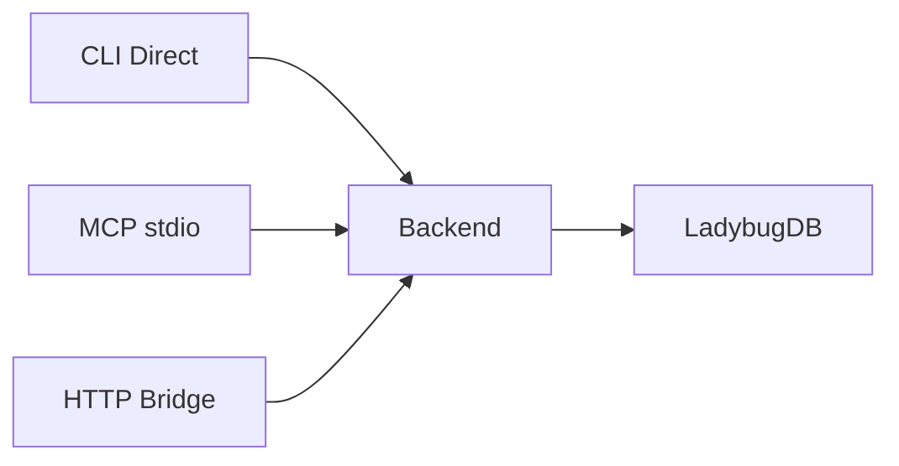

# (无标题)

- 会话 ID：`20260717_154234_e292ec`
- 时间：2026-07-17 07:42 UTC
- 来源：telegram ｜ 模型：deepseek-v4-flash
- 消息数：21

---

### **用户**

研究 GitNexus 项目：了解功能、架构、用途、亮点、部署方式、技术栈。返回完整分析

### **助手**

## GitNexus 项目完整分析

---

### 1. 项目概览

**GitNexus** 是一个"零服务器代码智能引擎"——一个客户端知识图谱构建工具，将任意代码库索引为完整的知识图谱（包含所有依赖、调用链、集群和执行流），然后通过 MCP（Model Context Protocol）工具暴露给 AI 智能体（Cursor、Claude Code、Codex 等），让 AI 在编辑代码时能准确理解代码库结构，避免破坏性变更。

| 项目 | 信息 |
|------|------|
| **仓库** | `abhigyanpatwari/GitNexus`（⚠️ 注意是 `patwari` 末尾有 **i**，非 `patwar`） |
| **标语** | "The nervous system for agent context"（AI 智能体的神经系统） |
| **许可** | PolyForm Noncommercial 1.0（非商业用途免费，商业需授权） |
| **最新版本** | v1.8.0（截至 2026-05-22） |
| **官方站点** | [gitnexus.vercel.app](https://gitnexus.vercel.app) |
| **企业站点** | [akonlabs.com](https://akonlabs.com) |

---

### 2. 核心功能

#### CLI + MCP 工具（推荐用于日常开发）

**17 个 MCP 工具：**

| 工具 | 功能 |
|------|------|
| `list_repos` | 发现所有已索引仓库 |
| `query` | 混合搜索（BM25 + 语义 + RRF 排名融合），按进程分组 |
| `context` | 360° 符号视图——调用者、被调用者、参与的执行流 |
| `impact` | 破坏范围（blast radius）分析——上游/下游、置信度评分 |
| `trace` | 两符号间最短有向路径 |
| `detect_changes` | Git diff → 影响符号和执行流映射 |
| `rename` | 图中辅助的多文件重命名（支持 dry-run） |
| `cypher` | 对知识图执行原始 Cypher 查询 |
| `route_map` | API 路由映射（组件→端点→处理函数） |
| `tool_map` | MCP/RPC 工具定义和处理函数 |
| `shape_check` | 验证 API 响应形状与消费者属性访问的一致性 |
| `api_impact` | API 路由处理器的变更前影响报告 |
| `explain` | 解释污点分析（taint）结果（需 `--pdg` 索引） |
| `pdg_query` | 控制/数据依赖查询（需 `--pdg` 索引） |
| `group_list` | 列出仓库组 |
| `group_sync` | 重建组的契约注册表 |

**10 个资源端点（Resource）：** 代码库概览、集群详情、执行流追踪、图模式、组合约等。

**2 个 MCP Prompt：** `detect_impact`（提交前分析）、`generate_map`（从知识图生成架构文档）。

**6 个预设 Agent Skills：** 探索、调试、影响分析、重构、工具指南、CLI 命令。

#### Web UI（浏览器端）

- 纯客户端图浏览器 + AI 对话
- 代码**绝不离开用户机器**
- 支持拖入 Git 仓库 URL（GitHub/GitLab/Azure/本地）或 ZIP 文件
- 可配合本地 `gitnexus serve` 后端工作（Bridge 模式）

---

### 3. 架构

#### 单体仓库（Monorepo）布局

| 路径 | 角色 |
|------|------|
| `gitnexus/` | npm 包：CLI、MCP 服务器、HTTP API、索引管线、LadybugDB 图、嵌入向量 |
| `gitnexus-web/` | Vite + React 瘦客户端：图浏览器 + AI 聊天 |
| `gitnexus-shared/` | CLI 和 Web 共享的 TypeScript 类型和常量 |
| `eval/` | 评估工具（Python 编写） |
| `.claude/`, `gitnexus-claude-plugin/` | Agent 技能和插件元数据 |

#### 端到端流程

```
索引（analyze）→ 知识图谱（KnowledgeGraph）→ 持久化（LadybugDB）→ 查询层（MCP/HTTP/CLI）
```

**索引管线（15 个阶段的有向无环图）：**

```
scan → structure → [markdown, cobol] → parse → [routes, tools, orm]
  → crossFile → scopeResolution → pruneLocalSymbols → mro → di → communities → processes
```

1. **扫描** — 遍历文件树
2. **结构** — 文件夹/文件节点关系
3. **解析** — Tree-sitter AST 提取函数、类、方法、接口
4. **跨文件** — 按导入拓扑顺序进行类型传播
5. **作用域解析** — 解析绑定、引用、继承边
6. **MRO** — 方法解析顺序（C3、first-wins 等）
7. **社区检测** — Leiden 算法将相关符号分组
8. **进程追踪** — 从入口点追踪执行流
9. **混合搜索** — BM25 + 语义嵌入

#### 查询层（三种接口）



#### 存储

```
<repo>/.gitnexus/     # 索引文件（在 .gitignore 中）
  ├── lbug            # LadybugDB 数据库
  ├── gitnexus.json   # 元数据（lastCommit, indexedAt, 统计信息）
~/.gitnexus/
  └── registry.json   # 全局仓库注册表（MCP 发现用）
```

---

### 4. 技术栈

| 层 | CLI（原生） | Web（浏览器） |
|------|-------------|---------------|
| **运行环境** | Node.js | 浏览器（WASM） |
| **解析器** | Tree-sitter 原生绑定 | Tree-sitter WASM |
| **数据库** | LadybugDB 原生 | LadybugDB WASM |
| **嵌入向量** | HuggingFace transformers.js（GPU/CPU） | transformers.js（WebGPU/WASM） |
| **搜索** | BM25 + 语义 + RRF 融合 | BM25 + 语义 + RRF 融合 |
| **Agent 接口** | MCP（stdio） | LangChain ReAct Agent |
| **可视化** | — | Sigma.js + Graphology（WebGL） |
| **前端** | — | React 18 + TypeScript + Vite + Tailwind v4 |
| **聚类** | Graphology | Graphology |
| **并发** | Worker threads + async | Web Workers + Comlink |

**已支持的语言（16 种）：** TypeScript、JavaScript、Python、Java、Kotlin、C#、Go、Rust、PHP、Ruby、Swift、C、C++、Dart、COBOL、Markdown。

其中14种通过 Tree-sitter + 统一捕获标签（`@definition.class`、`@call.name` 等）实现；4种可选语言（Dart/Proto/Swift/Kotlin）需要 C++ 工具链或可使用预构建。

---

### 5. 亮点与创新

1. **预计算关系智能（Precomputed Relational Intelligence）** — 区别于传统 Graph RAG（多次查询拼接答案），GitNexus 在索引时预先计算结构——聚类、追踪、评分——让工具一次调用就返回完整上下文，LLM 不会遗漏信息。

2. **模型民主化** — 由于工具承担了重活，即使较小的语言模型也能获得完整的架构清晰度。

3. **零服务器、隐私优先** — CLI 模式下代码永不离开本地；Web 模式下一切在浏览器中运行，无代码上传。

4. **通用捕获标签** — 16 种语言使用相同的语义捕获标签，下游提取无需按语言分支。

5. **15 阶段 DAG 管线** — 每个阶段有明确的依赖关系和类型安全的输出，编译时保障。

6. **完整的供应链保护** — 镜像通过 Cosign 密钥签名、Kubernetes 准入策略、SBOM 证明。

7. **多仓库 / 组架构** — 全局注册表让一个 MCP 服务器可以服务多个索引仓库，支持跨仓库影响分析。

---

### 6. 部署方式

| 方式 | 命令/步骤 |
|------|-----------|
| **npm 全局安装** | `npm install -g gitnexus` → `gitnexus analyze` → `gitnexus setup` |
| **npx 一次运行** | `npx gitnexus@latest analyze` |
| **pnpm 安装** | `pnpm --allow-build=@ladybugdb/core --allow-build=gitnexus --allow-build=tree-sitter dlx gitnexus@latest analyze` |
| **Docker** | `docker compose up -d`（两个镜像：CLI 后端 + Web 前端） |
| **Docker 手动** | `docker run ghcr.io/abhigyanpatwari/gitnexus:latest` |
| **Web UI 在线** | 浏览器打开 [gitnexus.vercel.app](https://gitnexus.vercel.app) |
| **本地开发** | 克隆仓库 → `cd gitnexus-shared && npm install && npm run build` → `cd ../gitnexus-web && npm install && npm run dev` |
| **Kubernetes** | 使用 `deploy/kubernetes/` 中的配置，配合 Sigstore policy-controller 强制执行镜像签名验证 |
| **企业版** | 托管 SaaS 或自托管，见 [akonlabs.com](https://akonlabs.com) |

---

### 7. 适用场景

| 场景 | 说明 |
|------|------|
| **日常开发** | AI 辅助编码时，避免破坏性编辑——编辑前跑 `impact` 分析破坏范围 |
| **代码审查** | PR 提交前自动检测变更影响 |
| **新开发者入职** | 快速理解不熟悉的代码库架构 |
| **代码重构** | 安全规划重命名和提取操作 |
| **Bug 调试** | 通过调用链追踪到问题根源 |
| **文档生成** | `gitnexus wiki` 从知识图生成代码文档 |
| **安全审计** | `--pdg` 索引 + taint 分析 |
| **多仓库协作** | 跨仓库影响分析和契约追踪 |

---

### 8. 注意事项

- **协议为 PolyForm Noncommercial** — 商业使用需通过 Akon Labs 获取授权
- **npm 11.x 有已知兼容问题** — 建议使用 pnpm 或全局安装
- **嵌入向量需要 ONNX Runtime** — 可选依赖，可通过环境变量控制安装行为
- **大仓库限制** — 嵌入向量默认 50,000 节点上限（可通过 `--embeddings 0` 取消）
- **无加密货币关联** — 官方声明无任何代币/币

---

*分析基于仓库最新版本（v1.8.0），通过克隆源代码、阅读 README.md 和 ARCHITECTURE.md 完成。*
